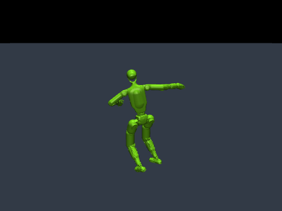
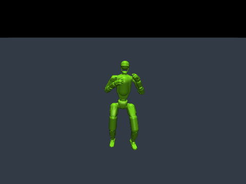
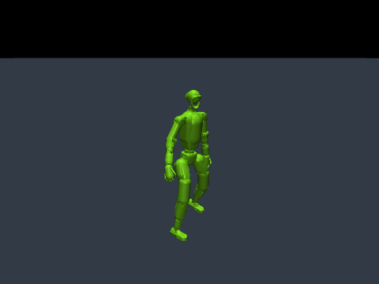

# MimicKit-mujoco

[English](README.md) | **한국어**

**Unitree G1(29 DoF)** 모방학습을 **Apple Silicon macOS**와 Linux에서 **MuJoCo 3.17.0**으로 실행합니다. [MimicKit](https://github.com/xbpeng/MimicKit)의 학습 알고리즘·모션 처리 코드에 기존 [**legged-gym-mujoco**](https://github.com/JihoonPark20/legged-gym-mujoco)의 CPU 배치 시뮬레이션 방식을 결합한 프로젝트입니다.

물리는 CPU에서 실행하며, PyTorch 학습 장치는 **CUDA가 있으면 CUDA, 없으면 CPU**를 자동 선택합니다. MPS는 `--device mps`로 직접 선택할 수 있습니다. 물리 시뮬레이션이 없는 단독 `train-prior`는 CUDA → MPS → CPU 선택을 유지합니다. 아래 MuJoCo 실행 명령에는 Isaac 설치가 필요하지 않습니다.

## 지원 알고리즘

| CLI 이름 | 방법 | 기본 G1 참조 데이터 |
|---|---|---|
| `deepmimic` | DeepMimic / PPO | 공식 보행 모션 |
| `awr` | Advantage-Weighted Regression | 공식 보행 모션 |
| `amp` | Adversarial Motion Priors | 공식 보행 모션 |
| `ase` | Adversarial Skill Embeddings | 공식 보행 + 달리기 데이터셋 |
| `lcp` | Lipschitz-Constrained Policies | 공식 보행 모션 |
| `add` | Adversarial Differential Discriminator | 공식 보행 모션 |
| `smp` | Score-Matching Motion Priors | 공식 보행 모션 + G1 확산 prior |

일곱 알고리즘의 원본 구현을 유지합니다. ASE의 두 모션은 실행 가능한 출발점이며, 다양한 기술을 갖춘 학습 결과를 의미하지 않습니다. SMP는 G1 prior를 먼저 학습하는 별도 명령을 제공합니다. Humanoid용 prior로 대체하면 안 됩니다.

**검증 상태:** Mac CPU와 MPS에서 일곱 알고리즘의 소규모 실제 학습 업데이트 및 체크포인트 생성을 확인했습니다. 재생·물리 검증은 [검증 기록](docs/MUJOCO_VALIDATION.md)에 정리되어 있습니다. 이 검증은 장시간 학습의 수렴이나 논문 결과 재현을 의미하지 않습니다. Linux/CUDA 장치 선택 경로는 제공하지만 이 워크스페이스에서는 해당 하드웨어로 검증하지 않았습니다. Linux에서도 물리는 CPU에서 실행합니다.

## 설치

**소스 체크아웃**과 **Python 3.10–3.13**을 사용하세요. 검증 버전은 Python 3.12입니다. `data/`, `mimickit/`, `mimickit_mujoco/`, `tools/`를 함께 유지하고 저장소 루트에서 실행합니다.

```bash
python3.12 -m venv .venv
source .venv/bin/activate
python -m pip install -e '.[test]'
python -m mimickit_mujoco fetch-data
python -m mimickit_mujoco doctor
```

[uv](https://docs.astral.sh/uv/)로 의존성을 재현할 수도 있습니다.

```bash
uv sync --python 3.12 --extra test
source .venv/bin/activate
python -m mimickit_mujoco fetch-data
```

Linux/NVIDIA에서는 [PyTorch 공식 설치 안내](https://pytorch.org/get-started/locally/)에 따라 CUDA용 PyTorch를 먼저 설치한 다음 `pip install -e .`을 실행하고 `--device cuda:0`을 지정하세요. CUDA는 학습을 가속하며 네이티브 MuJoCo 물리를 GPU로 옮기지는 않습니다. 편의 CLI는 학습 프로세스 하나를 실행합니다. 다중 GPU 실행은 원본 `mimickit/run.py`의 분산 실행 경로를 사용합니다.

## 공식 G1 모델과 모션

`fetch-data`로 공식 G1 모델·메시와 일곱 샘플 모션을 설치합니다. 내려받은 파일은 `data/assets/g1/`, `data/motions/g1/`에 저장되며 Git에는 포함되지 않습니다. 원본 라이선스를 함께 설치하며 파일별 체크섬은 [official_g1_manifest.json](data/official_g1_manifest.json)에 기록했습니다.

파일이 없으면 [MimicKit 공식 데이터 공유](https://1sfu-my.sharepoint.com/:u:/g/personal/xbpeng_sfu_ca/EclKq9pwdOBAl-17SogfMW0Bved4sodZBQ_5eZCiz9O--w?e=bqXBaa)에서 복원합니다.

```bash
python -m mimickit_mujoco fetch-data
# 이미 내려받은 공식 ZIP 사용
python -m mimickit_mujoco fetch-data --archive /path/to/MimicKit_Data.zip
```

다운로더는 약 384 MiB의 공식 번들을 내려받고, 고정된 체크섬으로 G1 파일만 검증·설치합니다. 로컬에서 수정한 파일은 덮어쓰지 않습니다. 생성 모션이나 제삼자 데이터로 대체하지 않습니다.

학습된 정책 없이 참조 보행 모션을 볼 수 있습니다.

```bash
# macOS 네이티브 뷰어
mjpython -m mimickit_mujoco view-motion --device cpu
# Linux에서는 mjpython 대신 python 사용

# 화면 없이 모션 처리 확인
python -m mimickit_mujoco view-motion --headless --steps 60
```

`--motion data/motions/g1/g1_run.pkl` 또는 MimicKit 데이터셋 YAML로 모션을 선택합니다. 포함된 vault 모션을 장애물과 함께 학습하려면 추가 장면·태스크 구현이 필요합니다.

## 모션 데모

`--demo`로 `spinkick`(회전 발차기), `kick_combo`(연속 발차기), `cartwheel`(옆돌기)을 선택합니다. 세 모션 모두 DeepMimic/PPO, AWR, AMP, ASE, LCP, ADD, SMP용 프리셋을 제공합니다. 옆돌기는 필요한 팔꿈치·손목 접촉 규칙을 포함하며, SMP는 해당 데모로 학습한 prior가 필요합니다.

참조 궤적 미리보기입니다. 학습된 정책이 아닌 모션 재생입니다.

| 회전 발차기 | 연속 발차기 | 옆돌기 |
|---|---|---|
|  |  |  |

```bash
python -m mimickit_mujoco list-demos
mjpython -m mimickit_mujoco view-motion --demo spinkick
python -m mimickit_mujoco train --algorithm amp --demo cartwheel --out-dir output/cartwheel_amp
```

Linux 뷰어는 `mjpython` 대신 `python`을 사용합니다. 세 모션의 참조 보기, 알고리즘별 학습, SMP prior, 정책 재생 방법은 [데모 안내](docs/G1_DEMOS.ko.md)에 정리했습니다. 사전학습 정책은 포함하지 않으며, 참조 모션 보기와 학습한 정책 재생은 별도 기능입니다.

사용자 데이터셋은 `--motion`으로 선택합니다. [발차기 데이터셋](data/datasets/dataset_g1_kicks.yaml)은 공식 회전·연속 발차기 모션을 같은 가중치로 샘플링합니다. `--demo`와 `--motion`은 동시에 사용할 수 없습니다.

## 학습

```bash
python -m mimickit_mujoco train --algorithm deepmimic --out-dir output/deepmimic_g1
python -m mimickit_mujoco train --algorithm amp --device mps --num-envs 64 --out-dir output/amp_g1
python -m mimickit_mujoco train --algorithm ase --device cpu --num-threads 4 --out-dir output/ase_g1
```

표의 이름을 `--algorithm`에 지정합니다. 기본값은 **환경 64개, CPU 스레드 4개, 10,001회 업데이트**, 원본 네트워크 크기, 뷰어 비활성화입니다. `--num-envs`, `--num-threads`, `--iterations`로 조정하세요. 사용 가능한 메모리에 맞춰 환경 수를 조정하세요.

설치·실행을 짧게 확인하려면:

```bash
python -m mimickit_mujoco train --algorithm deepmimic --smoke --out-dir output/smoke_g1
```

`--smoke`는 환경 4개, 작은 네트워크, 8스텝 rollout, 짧은 에피소드로 실제 업데이트 1회를 수행합니다. 이 체크포인트는 통합 테스트용이며 학습된 보행을 보여주지 않습니다. `--iterations 2`로 연속 업데이트를 확인할 수 있습니다. 새 학습은 기존 `model.pt`를 조용히 덮어쓰지 않습니다.

Mac에서 학습을 보려면 `mjpython ... train --visualize`를 사용하세요. 정책 재생과 참조 모션 보기는 네이티브 MuJoCo 창을 사용합니다. `Enter`로 일시정지·재개, `Space`로 한 프레임 진행, 창 닫기 또는 Ctrl-C로 종료합니다. `--headless`는 재생 창을 비활성화합니다.

## SMP: G1 prior 먼저 학습하기

```bash
python -m mimickit_mujoco train-prior --device mps --out-dir output/smp_prior_g1
python -m mimickit_mujoco train --algorithm smp --prior-dir output/smp_prior_g1 --out-dir output/smp_g1
```

Prior 기본값은 공식 보행 모션으로 **50,000회 업데이트**입니다. 모델과 설정을 함께 저장합니다. `--motion`으로 prior 데이터와 정책의 리셋 모션을 변경할 수 있습니다. 제공 설정은 G1 학습의 시작점이므로 학습된 prior와 정책의 동작 품질은 별도로 평가해야 합니다.

전체 학습과 별개로 파이프라인을 짧게 확인하려면:

```bash
python -m mimickit_mujoco train-prior --smoke --out-dir output/smp_prior_smoke
python -m mimickit_mujoco train --algorithm smp --smoke --prior-dir output/smp_prior_smoke --out-dir output/smp_smoke
```

## 체크포인트·재생·로그

각 학습 디렉토리에 `model.pt`, 중간 모델, `log.txt`, 실제 사용한 환경·엔진·에이전트 YAML, `run_config.json`을 저장합니다.

```bash
# macOS 뷰어, Linux에서는 python 사용
mjpython -m mimickit_mujoco play --checkpoint output/deepmimic_g1/model.pt

# 화면 없는 정책 재생
python -m mimickit_mujoco play --checkpoint output/deepmimic_g1/model.pt --headless --steps 600

# 저장된 가중치에서 새 디렉토리로 학습 이어가기
python -m mimickit_mujoco train --checkpoint output/deepmimic_g1/model.pt --iterations 1000 --out-dir output/deepmimic_g1_continued
```

재생 시 작은 smoke-test 네트워크를 포함한 저장 설정을 복원합니다. 설정 파일은 체크포인트 옆에 유지하세요. SMP는 prior 디렉토리도 필요합니다. `--checkpoint`는 **가중치와 정규화 통계**를 복원하며, optimizer·replay·난수·시뮬레이션 상태는 새로 시작합니다. 중단 시점의 완전한 상태 복원은 아닙니다. 다른 시뮬레이터에서 학습한 체크포인트는 MuJoCo에 맞는 조정이 필요할 수 있습니다.

`--logger tb`는 TensorBoard 이벤트를 기록합니다. `--logger wandb`를 지정하면 W&B 로깅을 활성화합니다. 기본 `txt` 로거는 학습 데이터를 업로드하지 않습니다. TensorBoard 웹 UI를 사용하려면 TensorBoard를 별도 설치하세요.

## 검증 및 코드 구조

```bash
python -m pytest -q
python tools/verify_mujoco.py --device cpu --out-dir output/verify_cpu
python tools/verify_mujoco.py --device mps --out-dir output/verify_mps
```

통합 검증 스크립트는 작은 G1 prior를 학습하고, 각 알고리즘을 두 번 업데이트한 뒤 체크포인트를 다시 읽어 재생하며 참조 모션도 확인합니다. 지정 디렉토리에 결과와 로그를 저장합니다.

- [MuJoCo 엔진](mimickit/engines/mujoco_engine.py): CPU 배치, 이름 기반 관절 매핑, implicit PD, 세계 좌표계 상태·접촉력, 부분 리셋, 참조 캐릭터 표시.
- [엔진 설정](data/engines/mujoco_engine.yaml): 제어 30 Hz, 물리 240 Hz.
- [G1 환경 설정](data/envs): 원본 G1 설정과 추가한 G1 ASE/SMP 설정.
- [CLI](mimickit_mujoco/cli.py): 장치 선택, 학습, 재생, 실제 설정 저장.
- [출처와 구현 범위](docs/MUJOCO_PORT.md).

MuJoCo 구현 대상은 **G1의 hinge 관절, 평지, 시각적 참조 캐릭터**입니다. 다른 로봇, 구형 관절 humanoid, 서로 상호작용하는 물체, 장애물 태스크는 백엔드 확장이 필요합니다. “모든 알고리즘”은 위 일곱 학습 방법을 의미하며, 원본의 모든 장면·로봇 지원을 의미하지는 않습니다. 기존 엔진 소스는 참고용으로 남아 있으며 각자의 의존성이 필요합니다.

## 출처와 라이선스

MimicKit 소스 기준 커밋은 `fbe1a36e878f036d6bf5521defb8eb3b8ab4170d`입니다. [Apache-2.0 라이선스](LICENSE)와 [인용 정보](CITATION.cff)를 유지합니다. 배치 실행 방식의 기반인 [legged-gym-mujoco](https://github.com/JihoonPark20/legged-gym-mujoco)의 [BSD 고지](licenses/legged-gym-mujoco-BSD-3-Clause.txt)와 제삼자 고지를 보존했습니다. G1 자산의 [Unitree 라이선스](licenses/unitree-g1-BSD-3-Clause.txt), 공식 데이터 번들의 [라이선스](data/LICENSE)도 보존했습니다.
