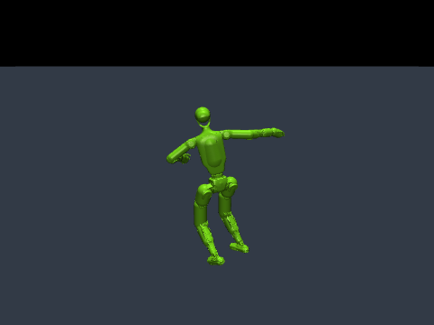
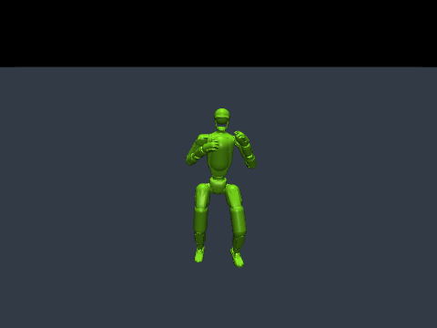
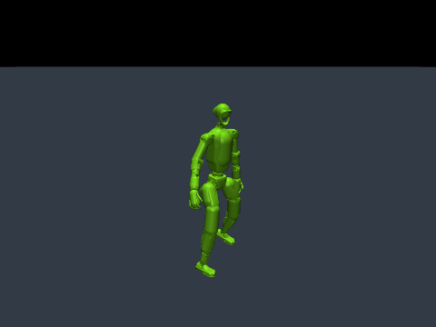

# MimicKit-mujoco

**English** | [한국어](README.ko.md)

Run **Unitree G1 (29 DoF)** motion imitation on **macOS Apple Silicon** and Linux using native **MuJoCo 3.17.0**. This project combines [MimicKit](https://github.com/xbpeng/MimicKit)'s learning algorithms and motion processing with the CPU batch simulation approach of [**legged-gym-mujoco**](https://github.com/JihoonPark20/legged-gym-mujoco) framework.

Physics runs on the CPU. The PyTorch learner automatically selects **CUDA if available, otherwise CPU**. Select MPS explicitly with `--device mps`. Standalone `train-prior` keeps CUDA → MPS → CPU selection because it does not run physics. No Isaac installation is needed for the MuJoCo commands below.

## Supported algorithms

| CLI name | Method | Default G1 reference data |
|---|---|---|
| `deepmimic` | DeepMimic / PPO | Official walk clip |
| `awr` | Advantage-Weighted Regression | Official walk clip |
| `amp` | Adversarial Motion Priors | Official walk clip |
| `ase` | Adversarial Skill Embeddings | Official walk + run dataset |
| `lcp` | Lipschitz-Constrained Policies | Official walk clip |
| `add` | Adversarial Differential Discriminator | Official walk clip |
| `smp` | Score-Matching Motion Priors | Official walk clip + a G1 diffusion prior |

All seven methods retain their upstream implementations. ASE's two-clip dataset is a runnable starting point, not a broad skill library. SMP includes a separate G1 prior-training command; a humanoid prior cannot be substituted for it.

**Validation:** all seven methods completed small real optimizer updates and checkpoint creation on Mac CPU and MPS. See [validation details](docs/MUJOCO_VALIDATION.md) for replay and physics checks. These checks do not establish training convergence or reproduce paper results. Linux/CUDA is supported by device selection but has not been hardware-tested here. Physics remains CPU-based on Linux as well.

## Installation

Use a **source checkout** and **Python 3.10–3.13**; Python 3.12 is the tested version. Keep `data/`, `mimickit/`, `mimickit_mujoco/`, and `tools/` together. Run the commands from the repository root.

```bash
python3.12 -m venv .venv
source .venv/bin/activate
python -m pip install -e '.[test]'
python -m mimickit_mujoco fetch-data
python -m mimickit_mujoco doctor
```

Alternatively, reproduce the resolved dependencies with [uv](https://docs.astral.sh/uv/):

```bash
uv sync --python 3.12 --extra test
source .venv/bin/activate
python -m mimickit_mujoco fetch-data
```

For Linux/NVIDIA, install the appropriate CUDA-enabled PyTorch build from the [official installer](https://pytorch.org/get-started/locally/) before `pip install -e .`, then select `--device cuda:0`. CUDA accelerates learning, not native MuJoCo physics. Multi-GPU orchestration is available through upstream `mimickit/run.py`; the convenience CLI runs one learner process.

## Official G1 assets and motions

Install the official G1 model, meshes and seven sample motions with `fetch-data`. The downloaded files live under `data/assets/g1/` and `data/motions/g1/` and are excluded from Git; their licenses are installed with them. File checksums are recorded in [official_g1_manifest.json](data/official_g1_manifest.json).

To install or restore files from the [official MimicKit data share](https://1sfu-my.sharepoint.com/:u:/g/personal/xbpeng_sfu_ca/EclKq9pwdOBAl-17SogfMW0Bved4sodZBQ_5eZCiz9O--w?e=bqXBaa):

```bash
python -m mimickit_mujoco fetch-data
# Or use an already downloaded official bundle:
python -m mimickit_mujoco fetch-data --archive /path/to/MimicKit_Data.zip
```

The downloader retrieves the approximately 384 MiB official bundle, verifies the pinned G1 subset, and preserves locally modified files. It does not substitute generated or third-party motions.

View the reference walk without a trained policy:

```bash
# macOS native viewer
mjpython -m mimickit_mujoco view-motion --device cpu
# Linux native viewer: replace mjpython with python

# Display-free inspection on either OS
python -m mimickit_mujoco view-motion --headless --steps 60
```

Use `--motion data/motions/g1/g1_run.pkl` or a MimicKit dataset YAML to choose another reference. The bundled vault clips require additional scene/task setup and are not evidence of supported obstacle interaction.

## Motion demos

Select `spinkick`, `kick_combo` or `cartwheel` with `--demo`. All three provide presets for DeepMimic/PPO, AWR, AMP, ASE, LCP, ADD and SMP. The cartwheel preset includes the required elbow/wrist contact rules; SMP requires a prior trained on the selected demo.

Reference trajectories (kinematic playback, not trained policies):

| Spinning kick | Kick combination | Cartwheel |
|---|---|---|
|  |  |  |

```bash
python -m mimickit_mujoco list-demos
mjpython -m mimickit_mujoco view-motion --demo spinkick
python -m mimickit_mujoco train --algorithm amp --demo cartwheel --out-dir output/cartwheel_amp
```

Use `python` instead of `mjpython` for the viewer on Linux. See the [demo guide](docs/G1_DEMOS.md) for all three reference-viewing commands, algorithm-specific training, SMP priors and policy playback. Pretrained policies are not bundled; reference playback and learned-policy playback are separate modes.

For custom datasets, use `--motion`. The [kicks dataset](data/datasets/dataset_g1_kicks.yaml) samples the official spinning-kick and kick-combination clips with equal weights. `--demo` and `--motion` are mutually exclusive.

## Train

```bash
python -m mimickit_mujoco train --algorithm deepmimic --out-dir output/deepmimic_g1
python -m mimickit_mujoco train --algorithm amp --device mps --num-envs 64 --out-dir output/amp_g1
python -m mimickit_mujoco train --algorithm ase --device cpu --num-threads 4 --out-dir output/ase_g1
```

Choose any method from the table with `--algorithm`. Defaults are **64 environments, 4 CPU threads, 10,001 iterations**, upstream network sizes, and no viewer. Set `--num-envs`, `--num-threads`, and `--iterations` to match available compute. Adjust the environment count to fit available memory.

For a quick installation check:

```bash
python -m mimickit_mujoco train --algorithm deepmimic --smoke --out-dir output/smoke_g1
```

`--smoke` uses 4 environments, small networks, 8-step rollouts, and a short episode for one real update. Its checkpoint is for integration testing and will not exhibit trained walking. `--iterations 2` exercises consecutive updates. An existing `model.pt` is never silently overwritten by a new run.

To view training on macOS, use `mjpython ... train --visualize`. Playback and reference viewing show a native MuJoCo window. `Enter` pauses/resumes, `Space` advances one frame, and closing the window or pressing Ctrl-C stops execution. Use `--headless` to disable playback visualization.

## SMP: train the G1 prior first

```bash
python -m mimickit_mujoco train-prior --device mps --out-dir output/smp_prior_g1
python -m mimickit_mujoco train --algorithm smp --prior-dir output/smp_prior_g1 --out-dir output/smp_g1
```

The prior defaults to **50,000 iterations** on the official walk. Its model and configuration are saved together. Use `--motion` to change its dataset and the matching policy's reset data. Evaluate the learned prior and policy before relying on their motion quality; these are initial G1 configurations.

A short pipeline check, separate from the full prior:

```bash
python -m mimickit_mujoco train-prior --smoke --out-dir output/smp_prior_smoke
python -m mimickit_mujoco train --algorithm smp --smoke --prior-dir output/smp_prior_smoke --out-dir output/smp_smoke
```

## Checkpoints, playback, and logs

Each training directory contains `model.pt`, intermediate models, `log.txt`, the effective environment/engine/agent YAMLs, and `run_config.json`.

```bash
# macOS viewer; Linux uses python
mjpython -m mimickit_mujoco play --checkpoint output/deepmimic_g1/model.pt

# Headless policy replay
python -m mimickit_mujoco play --checkpoint output/deepmimic_g1/model.pt --headless --steps 600

# Continue learning from saved weights into a new directory
python -m mimickit_mujoco train --checkpoint output/deepmimic_g1/model.pt --iterations 1000 --out-dir output/deepmimic_g1_continued
```

Playback restores the saved configuration, including small smoke-test networks. Keep the configuration files beside the checkpoint. SMP also needs its prior directory. `--checkpoint` restores **weights and normalizers**; optimizer, replay, RNG and simulation states restart. It is a warm start, not exact training resumption. Checkpoints trained with other simulators may require adaptation for MuJoCo.

`--logger tb` writes TensorBoard events; `--logger wandb` explicitly enables W&B logging. The default `txt` logger does not upload training data. Install TensorBoard separately if you want its web UI.

## Verification and implementation

```bash
python -m pytest -q
python tools/verify_mujoco.py --device cpu --out-dir output/verify_cpu
python tools/verify_mujoco.py --device mps --out-dir output/verify_mps
```

The integration script trains a small G1 prior, performs two updates of each algorithm, reloads each checkpoint, and replays reference motion. Results and logs are saved in the specified directory.

- [MuJoCo engine](mimickit/engines/mujoco_engine.py): persistent CPU batches, named joint mapping, implicit PD control, world-space state/contact sensors, partial resets, reference display.
- [Engine configuration](data/engines/mujoco_engine.yaml): 30 Hz control, 240 Hz physics.
- [G1 environment configurations](data/envs): original G1 tasks plus G1 ASE/SMP settings.
- [CLI](mimickit_mujoco/cli.py): device selection, training, playback and effective config storage.
- [Provenance and implementation scope](docs/MUJOCO_PORT.md).

The MuJoCo port targets **G1 hinge joints, flat ground, and visual reference characters**. Other upstream robot assets, spherical humanoid joints, interacting objects, and obstacle tasks need additional backend work. “All algorithms” refers to the seven learning methods above, not every upstream scene or robot. The original engine implementations remain in the source for reference and require their own dependencies.

## Attribution

MimicKit source is pinned to `fbe1a36e878f036d6bf5521defb8eb3b8ab4170d` and retains its [Apache-2.0 license](LICENSE) and [citation](CITATION.cff). The batch runtime approach derives from [legged-gym-mujoco](https://github.com/JihoonPark20/legged-gym-mujoco) framework; its [BSD notice](licenses/legged-gym-mujoco-BSD-3-Clause.txt) and third-party notices are retained. G1 assets retain the [Unitree license](licenses/unitree-g1-BSD-3-Clause.txt), and the official data bundle's [license](data/LICENSE) is preserved.
