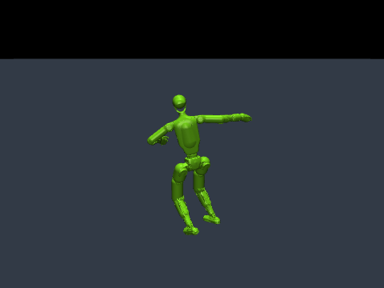
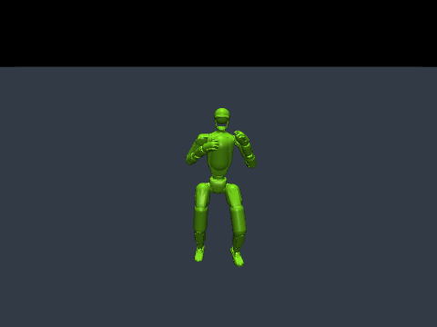
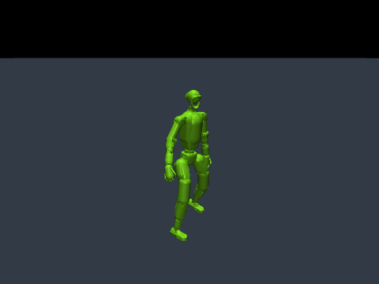

# G1 모션 데모

[English](G1_DEMOS.md) | **한국어**

MimicKit 공식 데이터 번들의 모션 세 가지를 데모로 제공합니다. 선택한 알고리즘에 모션 파일과 해당 동작의 접촉 규칙을 적용합니다.

| 데모 | 동작 | DeepMimic/PPO | AWR | AMP | ASE | LCP | ADD | SMP |
|---|---|---|---|---|---|---|---|---|
| `spinkick` | 회전 발차기 | ✓ | ✓ | ✓ | ✓ | ✓ | ✓ | prior 필요 |
| `kick_combo` | 연속 발차기 | ✓ | ✓ | ✓ | ✓ | ✓ | ✓ | prior 필요 |
| `cartwheel` | 옆돌기 | ✓ | ✓ | ✓ | ✓ | ✓ | ✓ | prior 필요 |

**참조 모션 보기와 학습을 위한 데모**이며, 사전학습된 정책 체크포인트는 포함하지 않습니다. 참조 재생은 제공된 궤적을 표시하고, 정책 재생은 직접 학습한 제어기를 실행합니다. Smoke 테스트 정책은 학습이 완료된 동작을 보여주지 않습니다.

참조 궤적 미리보기입니다. 학습된 정책이 아닌 모션 재생입니다.

| 회전 발차기 | 연속 발차기 | 옆돌기 |
|---|---|---|
|  |  |  |

GIF는 공식 G1 모델과 모션으로 생성했습니다. [모델 라이선스](../licenses/unitree-g1-BSD-3-Clause.txt)와 [데이터 라이선스](../data/LICENSE)를 보존합니다.

## 참조 모션 보기

[설치 안내](../README.ko.md#설치)에 따라 설치한 뒤 저장소 루트에서 실행합니다.

```bash
python -m mimickit_mujoco list-demos

# macOS 네이티브 뷰어. Linux에서는 mjpython 대신 python 사용.
mjpython -m mimickit_mujoco view-motion --demo spinkick
mjpython -m mimickit_mujoco view-motion --demo kick_combo
mjpython -m mimickit_mujoco view-motion --demo cartwheel
```

화면 없이 실행하려면 `python`과 `--headless --steps 300`을 사용합니다. 뷰어에서는 `Enter`로 일시정지·재개하고 `Space`로 한 프레임 진행합니다.

## 알고리즘별 학습

아래 명령의 `spinkick`을 원하는 데모 이름으로 바꾸세요. 실행마다 별도 출력 디렉토리를 사용합니다.

```bash
python -m mimickit_mujoco train --algorithm deepmimic --demo spinkick --out-dir output/spinkick/deepmimic
python -m mimickit_mujoco train --algorithm awr       --demo spinkick --out-dir output/spinkick/awr
python -m mimickit_mujoco train --algorithm amp       --demo spinkick --out-dir output/spinkick/amp
python -m mimickit_mujoco train --algorithm ase       --demo spinkick --out-dir output/spinkick/ase
python -m mimickit_mujoco train --algorithm lcp       --demo spinkick --out-dir output/spinkick/lcp
python -m mimickit_mujoco train --algorithm add       --demo spinkick --out-dir output/spinkick/add
```

SMP는 같은 데모로 학습한 prior가 필요합니다.

```bash
python -m mimickit_mujoco train-prior --demo spinkick --out-dir output/spinkick/prior
python -m mimickit_mujoco train --algorithm smp --demo spinkick --prior-dir output/spinkick/prior --out-dir output/spinkick/smp
```

`kick_combo`나 `cartwheel`도 각각 해당 모션의 prior를 학습한 뒤 SMP 정책을 학습하세요. CLI는 선택한 데모와 설정상의 모션이 다른 prior를 거부합니다. 정책 실행에 사용한 prior 파일과 설정을 함께 보관하세요.

`--demo`는 모션과 접촉 규칙을 함께 선택하므로 `--motion`과 동시에 사용할 수 없습니다. 사용자 모션이나 데이터셋에는 `--motion`을 사용하세요. ASE도 단일 모션으로 학습할 수 있지만, 각 데모는 한 동작의 학습 시작점이며 다양한 잠재 기술을 학습한 결과를 의미하지 않습니다.

## 옆돌기 접촉 규칙

옆돌기 데모는 MimicKit의 G1 환경에 제시된 목록에 따라 기본 하체 접촉 외에 팔꿈치·손목의 지면 접촉을 허용합니다. 머리·몸통 등 허용하지 않은 접촉에 대한 조기 종료는 유지합니다. 알고리즘별 나머지 종료 조건과 보상 설정도 유지합니다. 이 설정은 체크포인트와 함께 저장되므로 정책 재생 시 자동 복원됩니다.

프리셋은 [data/demos](../data/demos)에 있습니다. `--motion`으로 옆돌기 파일만 지정하면 데모의 접촉 규칙은 적용되지 않습니다.

## 학습한 정책 재생

```bash
# macOS 뷰어. Linux에서는 mjpython 대신 python 사용.
mjpython -m mimickit_mujoco play --checkpoint output/spinkick/amp/model.pt

# 화면 없이 재생
python -m mimickit_mujoco play --checkpoint output/spinkick/amp/model.pt --headless --steps 300
```

체크포인트 옆의 설정 파일에서 알고리즘·모션·접촉 규칙을 복원하므로 `--demo`를 다시 지정하지 않습니다. `--checkpoint`로 추가 학습을 시작할 때도 같습니다.

## 짧은 실행 확인

```bash
python -m mimickit_mujoco train --algorithm amp --demo cartwheel --smoke --iterations 2 --out-dir output/cartwheel_smoke
python -m mimickit_mujoco play --checkpoint output/cartwheel_smoke/model.pt --headless --steps 60
```

SMP는 먼저 `train-prior --demo cartwheel --smoke --out-dir output/cartwheel_prior_smoke`로 작은 prior를 만드세요. 그다음 위 정책 학습 명령에 `--algorithm smp`와 `--prior-dir output/cartwheel_prior_smoke`를 사용합니다.

세 데모와 일곱 알고리즘을 모두 확인하려면:

```bash
python tools/verify_demos.py --device cpu --out-dir output/verify_demos
```

지원되는 Mac에서는 `--device mps`를 사용할 수 있습니다. `--demos cartwheel --algorithms amp smp`로 확인 대상을 줄일 수도 있습니다. 스크립트는 각 참조 모션을 재생하고, SMP가 포함되면 해당 prior를 학습하며, 정책을 두 번 업데이트한 뒤 가중치 변경·유한값·저장된 프리셋을 확인하고 정책을 다시 읽어 재생합니다. 이는 실행 검증이며 학습 수렴이나 동작 추종 품질 검증은 아닙니다.
