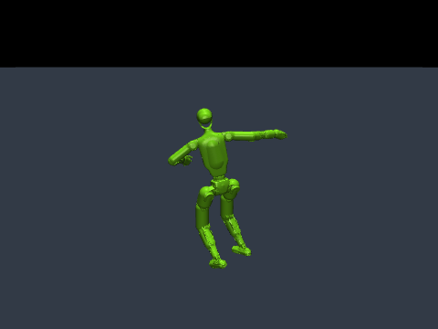
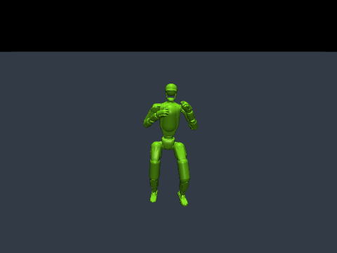
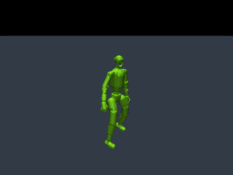

# G1 motion demos

**English** | [한국어](G1_DEMOS.ko.md)

Three demos use motion clips from the official MimicKit data bundle. Each preset selects the motion and its contact rules for the chosen algorithm.

| Demo | Motion | DeepMimic/PPO | AWR | AMP | ASE | LCP | ADD | SMP |
|---|---|---|---|---|---|---|---|---|
| `spinkick` | Spinning kick | ✓ | ✓ | ✓ | ✓ | ✓ | ✓ | Prior required |
| `kick_combo` | Kick combination | ✓ | ✓ | ✓ | ✓ | ✓ | ✓ | Prior required |
| `cartwheel` | Cartwheel | ✓ | ✓ | ✓ | ✓ | ✓ | ✓ | Prior required |

These are **reference-viewing and training demos**. Pretrained policy checkpoints are not bundled. Reference playback displays the supplied trajectory; policy playback displays a controller you have trained. A smoke-test policy does not reproduce a learned skill.

Reference trajectories (kinematic playback, not trained policies):

| Spinning kick | Kick combination | Cartwheel |
|---|---|---|
|  |  |  |

The GIFs are rendered from the official G1 model and motions; their [model license](../licenses/unitree-g1-BSD-3-Clause.txt) and [data license](../data/LICENSE) are retained.

## View a reference motion

Run from the source checkout after following the [installation instructions](../README.md#installation).

```bash
python -m mimickit_mujoco list-demos

# macOS: use mjpython for the native viewer. Linux: use python.
mjpython -m mimickit_mujoco view-motion --demo spinkick
mjpython -m mimickit_mujoco view-motion --demo kick_combo
mjpython -m mimickit_mujoco view-motion --demo cartwheel
```

For display-free execution, use `python` with `--headless --steps 300`. `Enter` pauses/resumes the viewer; `Space` advances one frame.

## Train with any supported algorithm

Choose one demo name and substitute it for `spinkick` in the commands below. Use a separate output directory for each run.

```bash
python -m mimickit_mujoco train --algorithm deepmimic --demo spinkick --out-dir output/spinkick/deepmimic
python -m mimickit_mujoco train --algorithm awr       --demo spinkick --out-dir output/spinkick/awr
python -m mimickit_mujoco train --algorithm amp       --demo spinkick --out-dir output/spinkick/amp
python -m mimickit_mujoco train --algorithm ase       --demo spinkick --out-dir output/spinkick/ase
python -m mimickit_mujoco train --algorithm lcp       --demo spinkick --out-dir output/spinkick/lcp
python -m mimickit_mujoco train --algorithm add       --demo spinkick --out-dir output/spinkick/add
```

SMP needs a prior trained on the same demo:

```bash
python -m mimickit_mujoco train-prior --demo spinkick --out-dir output/spinkick/prior
python -m mimickit_mujoco train --algorithm smp --demo spinkick --prior-dir output/spinkick/prior --out-dir output/spinkick/smp
```

Repeat the prior step for `kick_combo` or `cartwheel` before training its SMP policy. The CLI rejects a prior whose configured motion differs from the selected demo. Keep the prior files and effective configurations with your policy run.

`--demo` selects a complete preset and cannot be combined with `--motion`. For custom clips or datasets, use `--motion` instead. ASE can train with one clip; each demo is a single-motion starting point rather than a demonstration of a broad latent skill library.

## Cartwheel contact rules

The cartwheel preset permits ground contact by the elbows and wrists in addition to the default lower-leg contacts, following the cartwheel list in MimicKit's G1 environments. It retains early termination for disallowed contacts, including the head and torso. Other algorithm-specific termination and reward settings are retained. The preset is saved with the checkpoint, so policy playback restores these contact rules automatically.

The presets are in [data/demos](../data/demos). Selecting the raw cartwheel file with `--motion` alone does not apply the preset's contact rules.

## Play a trained policy

```bash
# macOS viewer; replace mjpython with python on Linux.
mjpython -m mimickit_mujoco play --checkpoint output/spinkick/amp/model.pt

# Headless playback
python -m mimickit_mujoco play --checkpoint output/spinkick/amp/model.pt --headless --steps 300
```

Playback restores the algorithm, motion and contact settings from the files beside the checkpoint; do not supply `--demo` again. The same rule applies when starting further training with `--checkpoint`.

## Quick execution check

```bash
python -m mimickit_mujoco train --algorithm amp --demo cartwheel --smoke --iterations 2 --out-dir output/cartwheel_smoke
python -m mimickit_mujoco play --checkpoint output/cartwheel_smoke/model.pt --headless --steps 60
```

For SMP, first train a small prior with `train-prior --demo cartwheel --smoke --out-dir output/cartwheel_prior_smoke`, then add `--prior-dir output/cartwheel_prior_smoke` to the smoke policy command with `--algorithm smp`.

To check all three demos and all seven algorithms:

```bash
python tools/verify_demos.py --device cpu --out-dir output/verify_demos
```

Use `--device mps` on a compatible Mac, or narrow the run with `--demos cartwheel --algorithms amp smp`. The script views every reference, trains a matching prior when SMP is selected, performs two small policy updates, checks changed/finite weights and saved presets, then reloads every policy for playback. These checks establish execution, not convergence or motion-tracking quality.
